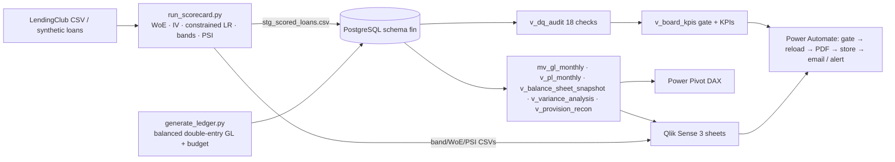

# Financial Analytics & Risk Reporting System

GL analytics (P&L, balance sheet, budget vs actual) + credit-risk scorecard (WoE / constrained logistic regression) +
self-gating board-pack delivery. **Read `docs/limitations.md` first**: everything quantitative here was produced on
*synthetic* data.

## What is verified vs. not

| Layer | Status |
|---|---|
| Python generator, WoE binner, scorecard, PSI | **Executed**, 19 unit tests pass |
| PostgreSQL DDL, ETL views, 18 data-quality audits, KPI feed | **Executed on PostgreSQL 16**, 4 SQL tests pass (incl. defect-injection) |
| Real LendingClub loader | Written, **not run** (no dataset access) |
| DAX, Qlik app, Power Automate | **Not executed** (spec/code written to the tested schema) |

## Status for reviewers

- **Reproduced locally (Windows, Python 3.14):** scorecard and ledger generation match the original run exactly; 19 Python tests pass.
- **Verified on PostgreSQL 16 (original build environment):** DDL, ETL, 18 audits, KPI feed, 4 SQL tests. Not yet re-run on the author's own machine.
- **Not yet validated:** DAX, Qlik app, Power Automate flow, and the real-LendingClub loader.
- All metrics in this repo come from synthetic data and say nothing about real-world model quality.

## Architecture



## Quick start

```bash
pip install -r requirements.txt
createdb finrisk
make all PGDATABASE=finrisk        # scorecard → ledger → load → ETL → audits → tests
# or step by step:
cd python_scorecard
python run_scorecard.py --synthetic 200000 --out ../data/scorecard_out --export-star ../data/synthetic
python generate_ledger.py --out ../data/synthetic --start 2019-01 --months 36 --anchor-ead <sum of ead from stg_scored_loans.csv>
cd .. && psql -d finrisk -f sql/01_ddl.sql   # then 00, 00b, 02, 03, 04 (in that order)
PGDATABASE=finrisk pytest tests -q
```
Real data: `python run_scorecard.py --lendingclub accepted_2007_to_2018.csv ...` (download from Kaggle yourself).
Volume test: `generate_ledger.py --split 400` → ~312k ledger lines.

**SQL order matters:** 01 → 00 → 00b → 02 → 03 → 04. Re-running 02 drops dependent views (`DROP MATERIALIZED VIEW … CASCADE`),
so re-run 03 and 04 afterwards; for routine refreshes use `REFRESH MATERIALIZED VIEW fin.mv_gl_monthly`.

## Layout
`sql/` DDL, load, ETL, audits, KPI feed · `python_scorecard/` generator, WoE, model, pipeline · `power_pivot/measures.dax` ·
`qlik_dashboards/` load script + spec · `power_automate/flow_spec.md` · `docs/` dataset evaluation, metric catalog,
limitations, deck outline, reflection matrix · `tests/` pytest (Python + SQL).

## Deliberate deviations from the brief
`normal_balance` on COA; `entry_batch_id` on GL (journal_id is a line id; balance can't be tested without a batch);
`outstanding_principal`/`recovery_amount` on performance; `dim_date`; `stg_scored_loans`; `v_board_kpis` gate;
hardened Qlik YTD/SPLY expressions; favourable-basis Variance % in DAX. Each is explained in the file where it appears.

## Headline results (synthetic data, seed 7)
Out-of-time test: AUC 0.637, Gini 0.274, KS 0.196, score PSI 0.002; bad-rate monotone across 5 bands (27.7% → 8.6%).
Including leaky `int_rate`/`grade` lifts Gini to 0.42 (the IV > 0.5 rule removes them). Modelled EL 13.6% of EAD vs booked
allowance 4.6%.
